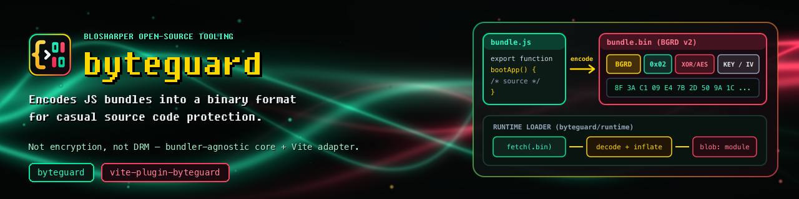

[](https://www.npmjs.com/package/byteguard)
[](https://www.npmjs.com/package/byteguard)
[](LICENSE)
[](https://www.npmjs.com/package/vite-plugin-byteguard)
[](https://www.npmjs.com/package/vite-plugin-byteguard)
[](LICENSE)

# byteguard

Encodes JS bundles into a binary format for casual source code protection.

**Not encryption, not DRM** — it raises the cost of reading a shipped bundle from
*open the file* to *reverse-engineer the loader*. Anything the runtime executes is
still recoverable by a determined attacker.

## Packages

| Package | Role |
| --- | --- |
| [`byteguard`](packages/byteguard) | Bundler-agnostic core — encoder, loader generation, algorithms |
| [`vite-plugin-byteguard`](packages/vite-plugin-byteguard) | Vite adapter |

The core has no `vite` or `rollup` imports, so other bundler adapters can be added
without touching it.

## Usage

```js
// vite.config.ts
import byteguard from 'vite-plugin-byteguard'

export default {
  plugins: [
    byteguard({
      algorithm: 'xor',   // or 'aes-gcm'
      exclude: ['**/legacy-*.js']
    })
  ]
}
```

The key travels in the file by default. To leave it out, compress the payload,
and encode workers as well:

```js
byteguard({
  algorithm: 'aes-gcm',
  keySource: 'native',   // the page supplies the key at runtime
  key: myKeyBytes,       // the same bytes the device will return
  compress: 'gzip',      // gzip, then encrypt
  workers: true          // start these with loadWorker, not new Worker
})
```

See [`packages/vite-plugin-byteguard`](packages/vite-plugin-byteguard) for the full
option list, and [`packages/byteguard`](packages/byteguard) for the binary format
and the `byteguard/runtime` half that runs in the page.

## License

MIT
