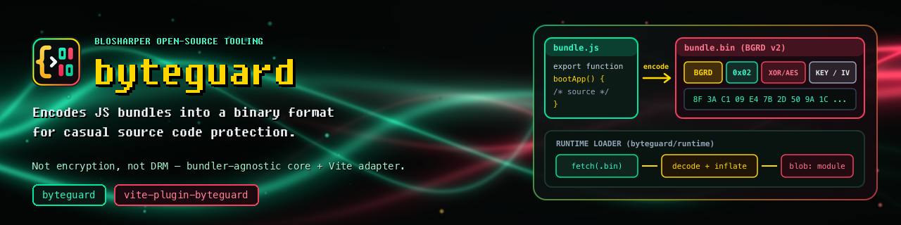

[](https://www.npmjs.com/package/byteguard)
[](https://www.npmjs.com/package/byteguard)
[](LICENSE)

# byteguard

Encodes JS bundles into a binary format for casual source code protection.
Bundler-agnostic core — no `vite` or `rollup` imports.

**Not encryption, not DRM** — it raises the cost of reading a shipped bundle from
*open the file* to *reverse-engineer the loader*. Anything the runtime executes is
still recoverable by a determined attacker.

Most users want the adapter instead:

- [`vite-plugin-byteguard`](https://www.npmjs.com/package/vite-plugin-byteguard)

Use this package directly only when writing an adapter for another bundler.

## Two entry points

| Import | Runs | Contains |
| --- | --- | --- |
| `byteguard` | build time, in Node | `encode`, `generateLoader`, the algorithms |
| `byteguard/runtime` | in the browser | `loadWorker`, `byteguardInflate` |

They are split because the build half imports `node:crypto` and `node:zlib`.
Application code importing `loadWorker` should use `byteguard/runtime`, so a
browser bundler never meets those.

## API

```js
import { encode, generateLoader } from 'byteguard'

// Encode a bundle into the binary container
const bin = encode(source, 'xor', 32)

// Generate the inline loader that fetches, decodes and runs it
const loader = generateLoader('assets/index.bin', 'xor', true)
```

| Export | Purpose |
| --- | --- |
| `encode` | Source → binary container (`BGRD` magic, versioned header) |
| `generateLoader` | Minimal inline browser loader for an encoded file |
| `xorEncode` / `aesEncode` | Algorithms |
| `byteguardInflate` | Gzip/DEFLATE decompression, dependency-free |
| `INFLATE_SOURCE` | The same function as text, for inlining into a loader |
| `MAGIC` `VERSION` `VERSION_FLAGS` `FLAG_GZIP` `ALG_XOR` `ALG_AES_GCM` | Container constants |

Algorithms: `xor` (default) and `aes-gcm`.

### `encode(js, algorithm?, keySize?, options?)`

```ts
encode(source, 'aes-gcm', 32, {
  keySource: 'header' | 'native',   // default 'header'
  fallback:  'none'   | 'header',   // default 'none'
  key:       Uint8Array | (() => Uint8Array),
  compress:  'none'   | 'gzip'      // default 'none'
})
```

With no `options`, this writes exactly what 0.4.1 wrote, byte for byte.

### `generateLoader(binPath, algorithm, isModule, options?)`

```ts
generateLoader('./assets/index.bin', 'aes-gcm', true, {
  keySource:   'header' | 'native',              // default 'header'
  keyProvider: '__byteguardKey',                 // default
  fallback:    'none' | 'header',                // default 'none'
  compress:    'none' | 'gzip',                  // default 'none'
  inflate:     'auto' | 'native' | 'inline'      // default 'auto'
})
```

The options must describe the same file `encode` produced. With no `options`,
this emits exactly the 0.4.1 loader.

## Where the key lives

`keySource: 'header'` (the default) puts the key in the file. Anyone who reads
the header can decode the payload; it stops casual browsing, nothing more.

`keySource: 'native'` leaves the key out. The loader takes it at runtime from a
global the host page defines before the loader runs — on mobile, typically a
native bridge — and the build is given the same bytes through `key`:

```js
// build
const bin = encode(source, 'aes-gcm', 32, { keySource: 'native', key })

// page, before the loader runs
window.__byteguardKey = keyFromNativePlugin   // bytes, or a function, or a promise
```

The provider may be a `Uint8Array`, an `ArrayBuffer`, a function returning
either, or a promise. `keyProvider` renames the global.

`fallback: 'header'` writes the key into the file **as well**, and the loader
uses it only when the provider is absent. That undoes the point of native
keys, so it belongs in simulator and debug builds — not in a release.

Without a key the loader throws before fetching or executing anything.

## Compression

`compress: 'gzip'` deflates the payload before encryption — that order, because
ciphertext does not compress. The loader inflates with `DecompressionStream`
where the engine has it, and with an inlined decoder (about 5 KB of loader
text) where it does not, which today means Safari below 16.4.

| `inflate` | Behaviour |
| --- | --- |
| `'auto'` (default) | `DecompressionStream`, falling back to the inlined decoder |
| `'native'` | `DecompressionStream` only — smallest loader, fails on older engines |
| `'inline'` | the inlined decoder always (`'fflate'` is accepted as an alias) |

> [!WARNING]
> Prefer `aes-gcm` whenever `compress` is on. A gzip payload starts with the
> known bytes `1f 8b 08`, and XOR against a known prefix hands the attacker
> that many bytes of the key directly — with a repeating key, every byte of it
> within the first key-length of the file. `xor` with `keySource: 'native'` is
> allowed, and it is still the weak combination.

## Workers

An encoded worker cannot be started by `new Worker(url)` — the browser would
fetch the `.bin` and try to parse it as JavaScript. `loadWorker` does the
fetching and decoding in the page first:

```js
import { loadWorker } from 'byteguard/runtime'

const worker = await loadWorker(workerUrl, { type: 'module' })
```

It reads the key the same way the entry loader did, so a page whose entry was
built by the same plugin needs no configuration. `keyProvider` and `key` are
accepted alongside the standard `WorkerOptions` if it does.

## Binary format

Version 1 — what every release before 0.5 wrote, and what is still written
whenever no flag is set:

```
Offset  Size    Description
0       4       Magic "BGRD" (0x42 0x47 0x52 0x44)
4       1       Version (0x01)
5       1       Algorithm (0x01=XOR, 0x02=AES-GCM)
6       2       Key length (uint16 LE) — 0 when the key is not in the file
8       N       Key bytes (absent when the length is 0)
--- AES-GCM only ---
8+N     1       IV length (12)
9+N     12      IV bytes
--- End ---
varies  rest    Encoded payload
```

Version 2 — written when a flag is set, which today means `compress: 'gzip'`:

```
Offset  Size    Description
0       4       Magic "BGRD"
4       1       Version (0x02)
5       1       Algorithm
6       1       Flags (bit 0: payload is gzipped)
7       2       Key length (uint16 LE)
9       N       Key bytes
--- AES-GCM only ---
9+N     1       IV length (12)
10+N    12      IV bytes
--- End ---
varies  rest    Encoded payload
```

Two things the version byte deliberately does **not** track:

- **A missing key does not bump it.** Every field is length-prefixed and the
  algorithm byte already says whether an IV section follows, so `KeyLen = 0`
  shortens the header without making it ambiguous.
- **The IV is never secret** and stays in the header in both key modes.

## License

MIT
